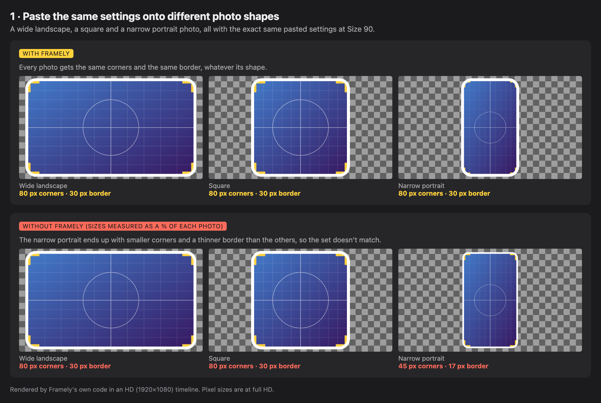
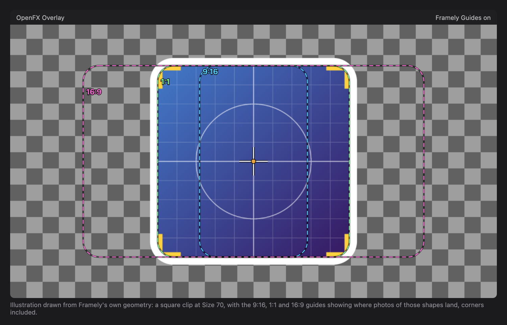
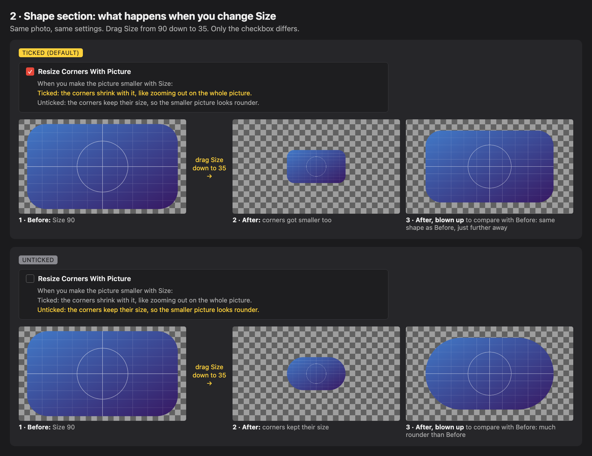
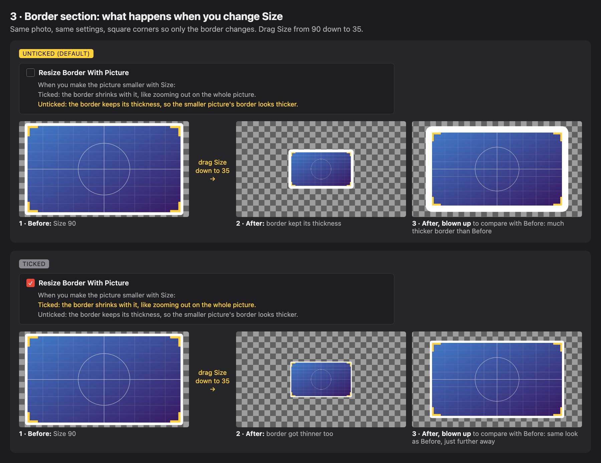
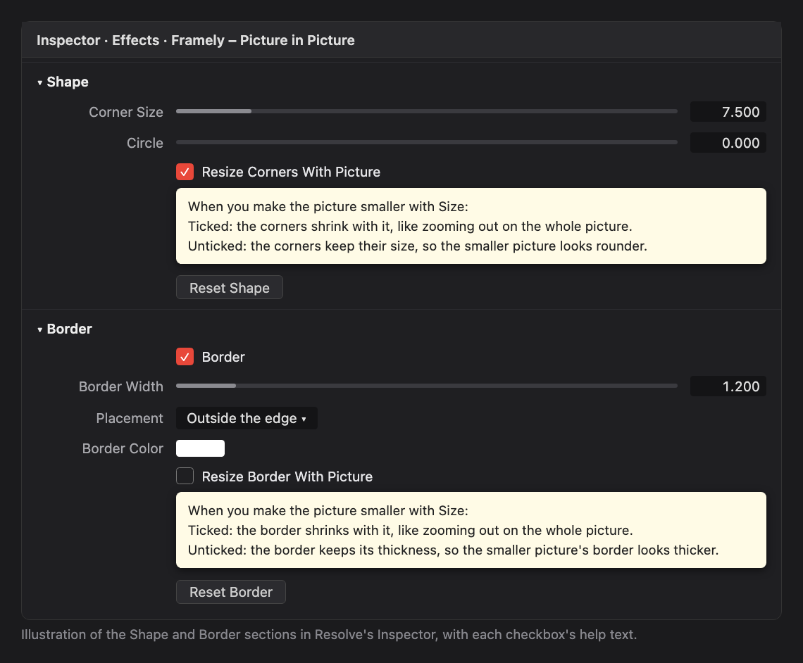

# Framely for DaVinci Resolve

**Framely – Picture in Picture** is an OpenFX effect for DaVinci Resolve Studio (tested on 21.2, macOS Apple Silicon).
It's a picture-in-picture that behaves predictably:

- **Centred, whole picture visible** the moment you apply it. No Inspector zoom-out workaround.
- **One look on every photo.** Paste the same settings onto a wide landscape, a square and a narrow portrait photo and
  they all get the exact same corners, border and shadow ([see below](#one-look-on-every-photo)).
- **No pixel values.** Every number is a %, so results don't depend on the timeline or photo resolution.
- **Size by** Fit in box, Crop to fill box (every picture is exactly the box; Pan picks what shows) or Scale ·
  Position · optional **safe area** with separate margins.
- **Crop**, then **Zoom/Pan** inside the window (crop never moves the image).
- **Corner Size** plus **Circle** 0–100%, and **Resize Corners With Picture** (ticked by default).
- **Border** outside or inside the edge, with **Resize Border With Picture** (unticked by default) ·
  **Drop shadow** (opacity, distance, softness, size, angle, colour).
  Turning border or shadow on/off never moves or resizes the picture. Edges are sharp and anti-aliased, never feathered.
- **Guides** in the viewer only (OpenFX Overlay): ghost outlines for 9:16, 4:5, 1:1, 4:3, 16:9 and a custom ratio,
  centre crosshair/dot, box and safe-area outlines, and a "no room" warning. Guides never appear in renders.
- **Presets** at the top: save looks by name, pick one to load it, set one as your default. Each section has a
  **Reset** button as its first row (resets the whole section), and Resolve's ↺ resets a single value.
- Drag the picture in the viewer (OpenFX Overlay); hold Option to pan the image inside.

> **Alpha.** This is an early public build (see Releases for the current version). Expect rough edges; please report issues.

## One look on every photo

Copy your Framely settings from one photo, paste them onto photos of any other shape, and the corners and border come
out the same.

Corner Size, Border Width and the shadow are a % of the **screen's** shorter side, never of the photo, so they don't
depend on the photo's shape. Crop and Pan stay a % of each image.

### 1 · Paste the same settings onto different photo shapes

A wide landscape, a square and a narrow portrait photo, all with the exact same pasted settings at Size 90.



In DaVinci Resolve you see this live: turn on Guides and set the viewer to OpenFX Overlay. The 9:16, 1:1 and 16:9
outlines show exactly where photos of those shapes would land, with their corners, using your current settings.



### 2 · Shape section: what happens when you change Size

Same photo, same settings. Drag Size from 90 down to 35. Only the checkbox differs.

> **Resize Corners With Picture** (ticked by default)\
> When you make the picture smaller with Size:\
> Ticked: the corners shrink with it, like zooming out on the whole picture.\
> Unticked: the corners keep their size, so the smaller picture looks rounder.



### 3 · Border section: what happens when you change Size

Same photo, same settings, square corners so only the border changes. Drag Size from 90 down to 35.

> **Resize Border With Picture** (unticked by default)\
> When you make the picture smaller with Size:\
> Ticked: the border shrinks with it, like zooming out on the whole picture.\
> Unticked: the border keeps its thickness, so the smaller picture's border looks thicker.



Ticking or unticking either box never rewrites your numbers; it only changes what happens when Size changes. At Size 100
both give the same result. The drop shadow always resizes with the picture. In **Fit in box** mode, "Size" means the
box: corners, border and shadow follow the box's size, never the photo's shape.



The pictures above are rendered by Framely's own code (the same code Resolve runs; `tools/docimages.py` rebuilds them).
The guides and Inspector pictures are illustrations drawn from that code, not screenshots.

## Install (macOS)

1. Download `Framely-macOS.zip` from [Releases](https://github.com/open-luc/Framely-for-DaVinci/releases) and unzip it.
2. Move `Framely.ofx.bundle` into `/Library/OFX/Plugins/` (Finder asks for your password).
3. Restart Resolve. Framely is under **Effects › Open FX › Framely**; searching "Picture in Picture" finds it.

Works on Apple Silicon and Intel Macs.

## Updating

Open the effect's **Updates** section in the Inspector:
**Check for Updates** looks on GitHub, **Install Update** downloads and installs the new version (macOS may ask for your
password), then restart Resolve. **Open Releases Page** opens this repo's downloads. Framely also checks quietly once a
day and renames the section to "Updates – vX.Y.Z available" when there's something new.

## Presets and your default

Open the **Presets** section at the top of the effect:

- **Save Preset** saves every setting under the name typed in **Preset Name**. Saving with an existing name updates it.
- Pick a preset in the **Preset** menu to load it. **Factory** is the built-in look.
- **Set as Default** makes the picked preset your default: new copies of the effect start with it, and **Reset to
  Default** and each section's **Reset** button go back to it. The menu marks it "(default)".
- **Delete Preset** moves the picked preset to the Trash.

Resolve's own ↺ arrow on each value goes back to the built-in factory value, so changing your default never changes
clips in older projects. Presets are plain text files in `~/Library/Application Support/Framely/Presets`; updating
Framely never touches them.

## Build

Needs Xcode command line tools. No CMake.

```bash
make            # builds build/Framely.ofx.bundle (arm64)
make dist       # universal (arm64 + x86_64) dist/Framely-macOS.zip
make install    # copies into /Library/OFX/Plugins/Framely.ofx.bundle (that folder must be writable by you)
make harness    # command-line renderer used for tests
```

## How it's tested

- `src/FramelyCore.h` holds all geometry and pixel maths with no OFX dependency. Its placement and crop geometry was
  checked against the original interactive spec on 400 random cases (`tools/mockcheck/mockgeom.js`, run with Deno).
- `tools/harness.cpp` renders the same maths to PNG. Frames rendered by Resolve itself (render queue, PNG) are compared
  pixel by pixel with the harness: 10 setting presets × portrait/square/landscape × 4K/HD/vertical (`tools/compare.py`).
- `tools/sizecheck.py` checks that corners, border and shadow come out identical, in pixels, on landscape, square,
  portrait and 9:21 photos, with each Resize box ticked and unticked, in Scale and Fit in box modes, on 4K, HD and
  vertical timelines.

## Known issues (alpha)

- After you change the viewer zoom, Resolve sometimes keeps drawing the guides at the old zoom (too big, Centre marker in
  the wrong place). Resizing the viewer, or changing the zoom again, redraws them correctly. The plugin draws in the
  coordinates Resolve gives it, so this looks like a Resolve issue (still investigating).
- Resolve doesn't tell plugins when you open or close a section, so sections can't remember your last choice between
  clips. Guides starts collapsed; the rest start open.
- A copy of the effect you never touch follows a later change of your saved default after Resolve restarts. Touch any
  setting to lock a clip.

## Notes

- Presets live in `~/Library/Application Support/Framely/Presets`, the default in `defaults.txt` next to it.
- Uses the OpenFX SDK 1.5.1 (BSD-3-Clause), vendored in `vendor/openfx` with one small patch (search `FRAMELY PATCH`).
